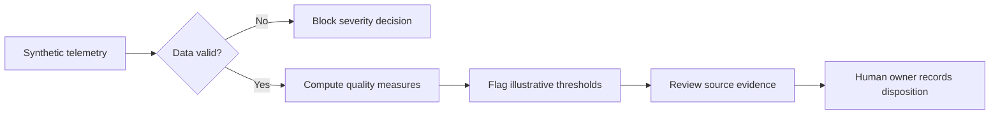

# ModelWatch | RAG Evaluation and Incident Review

**Interactive synthetic evaluation demo + reproducible Jupyter notebook**

[Try the interactive ModelWatch demo](https://modelwatch-ai-prototype-msk.lovable.app/) · [Explore the Python/Jupyter notebook](./ModelWatch%20RAG%20Monitor.ipynb)

> Academic portfolio prototype. The browser interface simulates monitoring, decisions, reviewer sign-off, and audit history. It does not call an LLM or connect to a production model. Notebook telemetry is synthetic.

## The challenge

An LLM support assistant can answer fluently while retrieval degrades, cited evidence mismatches the response, or user outcomes decline. A product or operations team needs **observable signals and defensible incident escalation** before it can intervene.

## What I designed and tested

- Pooled measures of **CSAT**, **retrieval success**, and **citation mismatch rate**, calculated with the correct period denominators.
- A clearly labeled summary of **daily p95 latency**, avoiding an incorrect claim that daily p95 values produce an overall p95.
- Data-integrity checks before assigning an incident severity, with blocked decisions for incomplete or impossible data.
- Thirteen notebook-based behavioral test cases for quality changes and invalid telemetry.
- A browser-based scenario explorer with reviewer notes, evidence confirmation, simulated decisions, and exportable review history.

## Example synthetic monitoring result

| Measure | Baseline | Current | Review implication |
| --- | ---: | ---: | --- |
| CSAT | 82.9% | 73.9% | Meaningful decline |
| Retrieval success | 90.1% | 79.1% | Retrieve and review examples |
| Citation mismatch | 1.7% | 6.2% | Verify claims against cited sources |
| Median daily p95 latency | 1.8 s | 1.8 s | No observed change in this statistic |

These sample numbers are synthetic demonstration values, not results from a real customer service.

## Monitoring workflow

## Try the interactive dashboard

1. Select **Stable**, **Partially Degraded**, **Degraded**, or **Invalid telemetry**.
2. Review the changed metric cards and calculated demonstration severity.
3. For a concerning scenario, mark the evidence checkboxes, choose an owner, and add reviewer notes.
4. Record **Escalate to human review** or **Resolve after review**.
5. Download the simulated review history as CSV. Data is stored locally in this browser; no backend service is connected.

The interactive reviewer interface is available through the linked Lovable prototype. The Jupyter notebook provides a separate synthetic evaluation implementation.

## Run the Python notebook

1. Open `ModelWatch RAG Monitor.ipynb` in Jupyter or Google Colab.
2. Install packages from `requirements.txt`, if using a local environment.
3. Run the cells in order. The notebook includes synthetic data, metrics, tests, and dashboard output.
4. Review the dashboard image in `assets/modelwatch-dashboard.png`.

## Evidence, limitations, and next steps

- Eight fabricated daily observations test branching logic; they cannot establish real-world drift or validated alert thresholds.
- A recorded knowledge-base update is a candidate investigation factor, not proof of causation.
- Human review remains the controlling decision point.
- Future work would include replay against labeled production incidents, independent evaluation of reviewer agreement, and tracking false alert burden.

## Tools and contribution

Python, pandas, NumPy, Matplotlib, Jupyter, HTML/CSS/JavaScript, Figma UX design. Project architecture and evaluation decisions were developed in Georgetown graduate coursework with AI-assisted coding and iterative review. The public prototype uses no real customer or patient information.
